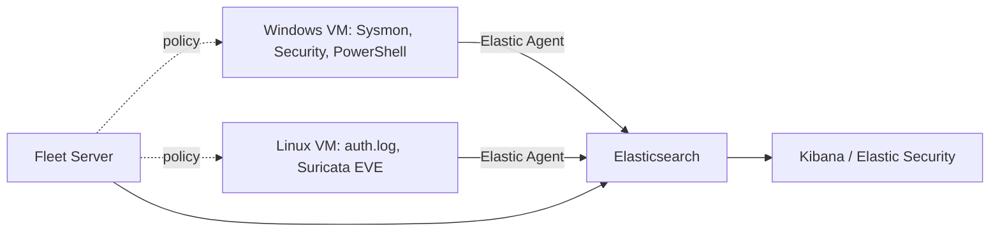

# SOC Home Lab

This lab collects Windows endpoint telemetry, Linux authentication logs and Suricata network events in Elastic Stack. Fleet manages the collectors. Kibana provides one dashboard for cross-source triage and Elastic Security runs custom rules against the lab's data streams.

## Quick start

1. On the isolated Elastic VM, copy `.env.example` to `.env` and set the local values described in [Setup](docs/setup.md). Run `docker compose config --quiet` and `docker compose up -d`.
2. Install Fleet Server and enroll the endpoint agents. Configure the Windows, System and Suricata integrations with namespace `lab`. Follow the [integration settings](configs/elastic/fleet-integrations.md) and inspect the [ECS mappings](docs/ecs-mapping.md).
3. Import [the dashboard](detections/dashboard.ndjson) in Kibana Saved Objects and [the rules](detections/rules.ndjson) in Elastic Security. Run the [benign controls](simulations/README.md) and record evidence in [the coverage table](results/coverage.md).

## Repository structure

| Path | Contents |
| --- | --- |
| `compose.yml` | Elasticsearch and Kibana with local prerequisites |
| `configs/` | Sysmon XML, Suricata EVE and custom rules, and Fleet integration settings |
| `detections/` | Elastic Security rule import and Kibana saved objects |
| `simulations/` | ATT&CK references and benign controls |
| `results/` | Coverage and baseline worksheet |
| `docs/` | Network diagram, setup, field mapping, screenshot plan and verification |

## Verification

The [local transcript](docs/verification.txt) records the checks and their outcomes. [NEEDS_USER_RUN.md](NEEDS_USER_RUN.md) lists end-to-end lab checks.

## Results

- In the local smoke test, Elastic generated one alert for each of three synthetic controls. Suricata generated both marker signatures from an offline capture. See [verification output](docs/verification.txt).
- Live data streams and dashboard screenshots — TODO(user): fill after running.
- Detection coverage and benign baseline — TODO(user): fill after running in [results/coverage.md](results/coverage.md).

## Limitations

- Fleet settings use the `lab` namespace. Update rule indices and the dashboard data view if you change it.
- The sensor sees traffic visible on its configured interface. The HTTP marker uses cleartext and the DNS marker requires visible DNS.
- The single-node deployment uses loopback HTTP for the Kibana UI. The example Suricata rules are deliberate telemetry markers. One failed logon has limited analytical value without account history and context.

## MITRE ATT&CK mapping

| Technique | Rule | Evidence to inspect |
| --- | --- | --- |
| [T1059.001 PowerShell](https://attack.mitre.org/techniques/T1059/001/) | SOC Lab PowerShell marker | Script block event 4104; corroborate with Sysmon process creation |
| [T1110.001 Password Guessing](https://attack.mitre.org/techniques/T1110/001/) | Failed Remote Interactive Logon | Security event 4625 with LogonType 10; assess frequency and context |
| Lab control | SOC Lab Suricata marker | EVE alert with SID 1000001 or 1000002 |
