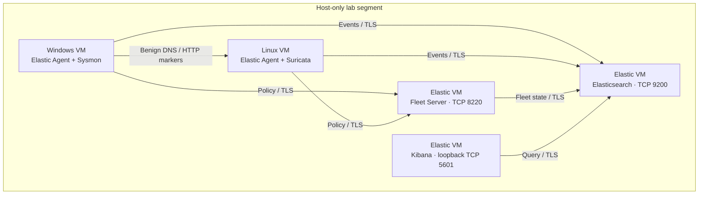

# Network layout

Bind Elasticsearch to the Elastic VM's host-only address for endpoint ingestion. Resolve the hostname used by Elasticsearch and Fleet Server on every agent VM. On a virtual switch without port mirroring, the Linux VM sees traffic to and from itself. Place the marker services on that VM or attach the sensor to the lab mirror.
